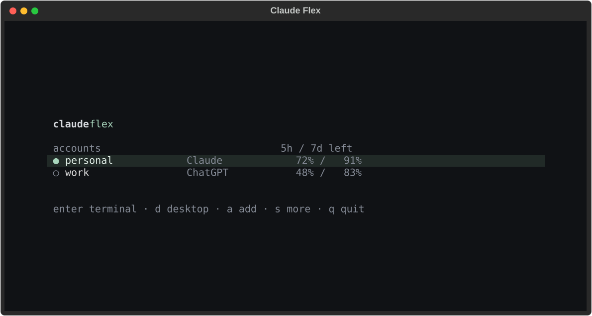

<div align="center">

# claude flex

**Choose your account. Pick your model in Claude Code.**

A minimal terminal account switcher for Claude Code. Manage Claude and ChatGPT
sign-ins, see remaining limits, and keep model selection in Claude Code's own
`/model` menu.

[](https://github.com/matrixdurden/claude-flex/actions/workflows/test.yml)
[](LICENSE)
[](pyproject.toml)



</div>

## Use it

Install [Claude Code](https://code.claude.com/docs/en/setup) and
[uv](https://docs.astral.sh/uv/getting-started/installation/), then:

```bash
uv tool install git+https://github.com/matrixdurden/claude-flex.git
claude-flex
```

1. **a** → choose Claude / ChatGPT → choose a sign-in method → sign in.
2. Choose an account. **Enter** opens Claude Code in this terminal; **d** opens Desktop.
3. Choose the model in Claude Code's own **`/model`** menu or Desktop picker.

That's the separation: **Flex selects accounts; Claude Code selects models.**
No model list or model picker appears in Flex. Your native
model choice is preserved when switching accounts of the same provider.

Exit Claude Code to return to Flex. The account connection also stays available
to your normal `claude` command. Claude Desktop is optional.
Linux, macOS, Windows and WSL are supported.

## Accounts

- Claude Pro / Max browser sign-in, or a copyable sign-in link.
- ChatGPT / Codex browser sign-in, device code, or existing OpenCode sign-in.
- Separate credentials per account; refresh ownership is not cloned from an
  actively running external client.
- Automatic account names and duplicate-identity detection.
- Account renewal, enable/pause, removal, weights and provider-specific pools.

Enter and **d** select the highlighted account, prepare the connection and open
the chosen application. Other providers' accounts aren't disabled. Changes
may briefly restart the gateway; finish an active generation before switching.

## Models belong in `/model`

Flex loads live conversational model catalogs from connected providers and
publishes them to the native Claude Code picker. GPT models use their actual
IDs, such as `gpt-6.1-sol`, and their real display names — not Sonnet-shaped
aliases. The built-in picker is limited to the connected routes.

The connection does **not** pass a forced `--model` flag, map every Claude tier
to one GPT model, or pin subagents to a Flex-selected model. The normal Claude
Code model selection remains in control. Older running-session aliases are kept
only as backward-compatible gateway routes, not as visible picker rows.

Claude Code **2.1.242+** is required for custom native picker rows; use an
up-to-date version for the latest behavior. Provider model support and usage
limits still apply. Models need reliable tool-call support to act as coding agents.

OpenAI, Anthropic, Gemini, OpenRouter, Groq, GitHub Models, Ollama, LM Studio
and compatible API sources can be connected under **s → API provider**.
API keys use a masked input. Discovered models appear in Claude Code, not Flex.

## Limits

The account list shows **remaining** short/long-window percentages.
Reset times and detailed provider/model windows are under **s → Account details**.

- ChatGPT accounts: **Codex usage**, not general ChatGPT chat-message quotas.
- Claude accounts: provider-returned Claude OAuth usage windows.
- Unknown values stay **—**; a `*` marks a stale successful snapshot.
- Quota queries are read-only and cached, with background refresh every minute.
- A 429 usage-limit response is a provider quota limit; select another account
  with available capacity or wait for its reset.

## Keys

| Key | Action |
| --- | --- |
| `↑` / `↓` | Choose an account |
| `Enter` | Open terminal Claude Code with the selected account |
| `d` | Open Claude Desktop with the selected account |
| `a` | Add an account |
| `Space` | Enable/pause an account in the pool |
| `r` | Refresh limits and the native model catalog |
| `s` | Details, renewal and advanced settings |
| `Esc` | Back/cancel sign-in |
| `q` | Exit Flex; the selected connection remains available |

Desktop's connection profile is applied automatically before opening. If an
already-running Desktop app has an older profile, Flex shows only **Restart
Desktop.** until the app has been fully reopened. The native model picker stays
in charge in both terminal and Desktop.

## Connection and storage

Selecting an account updates the native `~/.claude/settings.json` (or
`CLAUDE_CONFIG_DIR/settings.json`) with the gateway connection and the `/model`
lineup. An original-settings backup is stored privately in the Flex state folder.
Unrelated preferences and permissions are preserved. Gateway and upstream
credentials are never checked into this repository.

| Platform | Private state directory |
| --- | --- |
| Linux / WSL | `~/.config/claude-flex` (or `$XDG_CONFIG_HOME/claude-flex`) |
| macOS | `~/Library/Application Support/Claude-Flex` |
| Windows | `%LOCALAPPDATA%\Claude-Flex` |

Override Flex state with `CLAUDE_FLEX_HOME` or `claude-flex --home PATH`.
The verified gateway is prepared automatically and listens on loopback port 8318.
There is no web management server or telemetry in Flex.

Optional automation: `claude-flex run --account work -- -p "Hello"`,
`claude-flex doctor`, and `claude-flex gateway stop`.

## Development

```bash
uv sync
uv run python -m unittest discover -s tests -v
uvx ruff check .
uv build
```

Real-backend integration tests use a local synthetic provider:

```bash
CLAUDE_FLEX_TEST_BACKEND=/path/to/cli-proxy-api uv run python -m unittest tests.test_integration -v
```

Tests and generated screenshots use synthetic credentials and make no cloud
inference calls. [Contributing](CONTRIBUTING.md) ·
[Architecture](docs/architecture.md) · [Türkçe](docs/README.tr.md)

## License

[MIT](LICENSE). Built with [Textual](https://github.com/Textualize/textual) and
[CLIProxyAPI](https://github.com/router-for-me/CLIProxyAPI), a separately downloaded
MIT-licensed gateway. Claude Code and Claude Desktop are Anthropic products.
This independent project is not endorsed by Anthropic or OpenAI.
